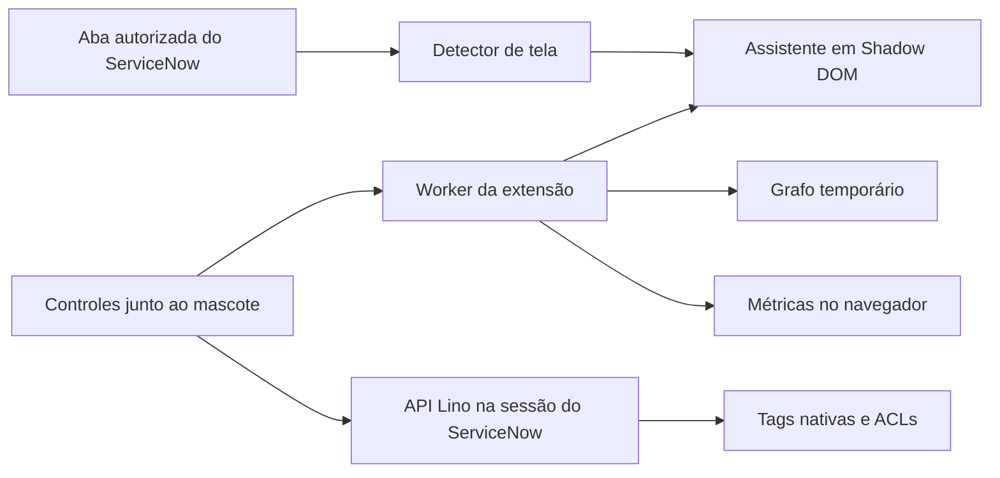

# Arquitetura e critérios do piloto do Lino

O Lino acompanha o analista durante a classificação de chamados no ServiceNow. Na versão 0.5, um clique no mascote abre os controles de classificação, revisão e remoção de tags junto ao chamado. Outro clique ou Esc recolhe a janela.

## Componentes e dados

- O worker registra o script apenas para a origem configurada com permissão concedida. O detector lê listas e registros clássicos, o iframe clássico e os padrões de URL de workspace documentados no brief. A leitura de shadow roots é limitada a 5.000 nós e 12 níveis de raízes.
- A página usa o rig SVG inline. Os controles abrem em um iframe da extensão posicionado junto ao mascote. O worker emite uma autorização curta de uso único para vincular o iframe à aba e à URL que o abriu. O balão mantém contraste próprio sobre o ServiceNow, e os controles usam Liquid Glass e foco visível. As poses respeitam a preferência de movimento reduzido.
- Incidentes são classificados pela API Lino usando a sessão e as ACLs do ServiceNow. Problemas e mudanças usam o fluxo legado. Em workspace, o assistente oferece o formulário clássico para esses dois tipos. Uma lista de workspace com linhas inacessíveis ainda pode ser reconhecida, e a classificação fica disponível no registro individual.
- A visão expandida usa uma cópia temporária do grafo em `chrome.storage.session`, com expiração de dez minutos. Essa cópia contém identificadores, números e títulos curtos dos registros. A telemetria usa outra chave, `lino:metricas`, e guarda somente evento, horário, tipo de interface e duração quando disponível. O buffer tem retenção de 30 dias, com limite de 500 eventos e 200 KB. Exportação e exclusão são manuais nas configurações.

## Direção de interface

A fila de incidentes, as etiquetas, o crachá do chamado, as etapas da triagem e as conexões do grafo formam a linguagem visual. O verde `#7DDE21` marca a ação e a conclusão. O fundo `#101612`, o balão `#1A251D`, o texto `#F4F8F2`, os metadados `#ACBCA9` e o foco `#A8F769` compõem as superfícies de trabalho. A interface usa Inter local no painel, números tabulares para progresso e espaçamento em múltiplos de 4 px.

O balão mostra uma etapa, o andamento quando houver contagem e uma ação quando o analista precisa intervir. Os chips recuperam etapas anteriores. As barras no resultado agrupam adições, tags existentes e falhas. A busca e os filtros ficam no grafo expandido. O avatar foi gerado com Imagegen a partir da referência de identidade do robô, com enquadramento frontal, sorriso discreto, casco branco, faixa verde, átomo amarelo, visor preto, olhos verde-limão, headset e fundo transparente.

## Como decidir sobre o piloto

Revise semanalmente com a equipe de triagem. As metas abaixo vêm do brief e precisam de uma linha de base do piloto. Consolide as amostras brutas por tipo de interface, registre a quantidade de observações e calcule o percentil sobre as durações individuais. Dê preferência a dados obtidos com a extensão instalada na DEMO.

| KPI | Cálculo e fonte | Meta proposta | Decisão |
|---|---|---|---|
| Tempo até contexto útil | p75 das durações dos eventos `informacao`. A instrumentação atual começa na navegação ou no início do script. | Até 1 s | Investigar separadamente detecção, montagem e espera da página. |
| Tempo até o mascote aparecer | p75 do evento `aparicao`, por interface. Em carregamento completo o relógio começa quando o script inicia. Complemente com gravação de navegação no DevTools. | Até 500 ms no clássico e 800 ms no workspace | Ajustar o gatilho ou adiar trabalho que não precisa ocorrer no primeiro quadro. |
| Precisão da detecção | Falsos positivos em telas negativas e falsos negativos divididos pelas telas elegíveis. Rodar a matriz e repetir na DEMO. | 0 falsos positivos em pelo menos 32 cenários e até 5% de falsos negativos | Bloquear a ampliação do piloto se o mascote aparecer em telas indevidas. |

Use o tempo de entrega dos balões para diagnosticar atrasos e os eventos de dispensa como sinais para entrevistas. Os eventos atuais de dispensa admitem repetições. Para calcular a taxa da primeira sessão, conte uma vez por participante em um roteiro de teste e use o total de primeiras sessões observadas como denominador.

As condições para ampliar o piloto são zero controles nativos encobertos no roteiro de cliques e zero dados de chamados ou identidade nos eventos exportados. Confira também o comportamento com teclado, NVDA, movimento reduzido, modais nativos, abas de trabalho e dispositivos com CPU limitada.

## Verificação e decisões em aberto

- O pacote carregado na página soma 16.426 bytes gzip. O SVG ocupa 4.233 bytes e o CSS de poses, 1.925 bytes. O contraste calculado do texto sobre o balão é 14,74:1 para o texto principal, 9,69:1 para o texto de suporte, 7,93:1 para metadados e 6,29:1 para texto atenuado. Esses valores são do pacote e das cores do código. Latência e impacto no carregamento continuam sujeitos à medição do piloto.
- Os testes de detecção exercitam URLs clássicas e de workspace com DOM simulado. Os testes de interface usam um Chrome local com página e APIs simuladas. O ensaio na DEMO deve confirmar os seletores reais do workspace, a detecção de modais e a classificação com conta de analista.
- Ao abrir o legado pelo painel, ele recebe a aba do ServiceNow de onde o analista partiu. As abas de processamento são marcadas antes de navegar. A ativação de novas tabelas e variantes de URL depende de casos reais para validar.
- A folha de poses vetoriais está no demo do rig. A vista 3/4, o turnaround 3D, o vídeo e as demais imagens de destaque ainda dependem de produção e revisão de identidade visual.
- Para executar os testes, use `node --test extensao/tests/*.test.mjs`. Para repetir a inspeção visual, aponte `PLAYWRIGHT_MODULE` para o pacote Playwright e execute `node extensao/tests/visual-mascote.cjs`.
